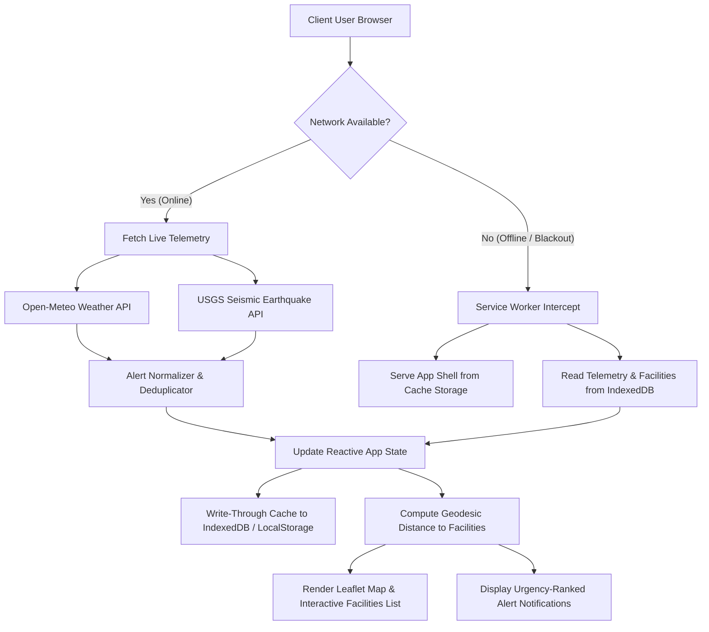

# ResQAlert — Disaster Warning & Emergency Resource Progressive Web App (PWA)

[](https://opensource.org/licenses/MIT)
[-success.svg)](https://developer.mozilla.org/en-US/docs/Web/Progressive_web_apps)
[]()
[](https://react.dev/)
[]()
[]()

A client-side, offline-first Progressive Web Application (PWA) engineered to provide hyper-localized natural disaster early warnings, automated life-safety guidance, interactive emergency facility routing, **Emergency SOS broadcasts**, **authenticated authority command dispatch**, **resilient offline SOS queuing**, and **geotagged community hazard reporting**.

Developed as a Final Year Computer Science & Engineering (B.Tech CSE) Capstone Project.

---

## Table of Contents
1. [Executive Summary & Problem Statement](#1-executive-summary--problem-statement)
2. [100% Software-Only Compliance Statement](#2-100-software-only-compliance-statement)
3. [Phase 1 Integrated Feature Architecture](#3-phase-1-integrated-feature-architecture)
4. [System Architecture & Data Flow](#4-system-architecture--data-flow)
5. [Authority Command Center & Demo Accounts](#5-authority-command-center--demo-accounts)
6. [Offline SOS Queueing & Safe Exponential Retry](#6-offline-sos-queueing--safe-exponential-retry)
7. [Geotagged Community Hazard Reporting Pipeline](#7-geotagged-community-hazard-reporting-pipeline)
8. [Automated Verification & Testing Suite (50/50 Tests)](#8-automated-verification--testing-suite-5050-tests)
9. [Viva Voce Technical Defense Q&A](#9-viva-voce-technical-defense-qa)
10. [Installation & Windows PowerShell Setup Guide](#10-installation--windows-powershell-setup-guide)
11. [Security, Privacy & Known Limitations](#11-security-privacy--known-limitations)

---

## 1. Executive Summary & Problem Statement

During acute natural hazards (flash floods, earthquakes, severe cyclonic depressions, and wildfire outbreaks), conventional telecommunication grids experience severe packet drops, localized cellular tower power blackouts, and backhaul congestion. Conventional native smartphone apps or heavy server-side portals frequently fail under these conditions because they require continuous, high-throughput network connectivity and heavy client-server handshakes.

**ResQAlert** addresses this critical failure mode through an **Offline-First Progressive Web Architecture**:
- Delivers real-time emergency telemetry across modern web browsers without native app store installation.
- Functions seamlessly in complete zero-connectivity blackout environments via dual-layer caching (Service Worker Cache Storage API + client-side IndexedDB).
- Calculates geodesic distances to critical emergency resources on the client CPU using the spherical **Haversine formula**, avoiding roundtrips to external routing servers.
- Features an adaptive **Data Saver** mode and connection throttling detector that downshifts data polling frequencies during 2G/3G network distress.

---

## 2. 100% Software-Only Compliance Statement

> **Formal Declaration:** ResQAlert is strictly a **100% software-based web application**. 
> - **Zero Microcontrollers:** No Arduino, ESP8266, ESP32, Raspberry Pi, or external peripheral boards are required or utilized.
> - **Zero External Transceivers:** No physical GPS modules (such as NEO-6M), LoRa modules, or hardware radios are needed.
> - **Standard W3C Standards:** Geolocation is sourced exclusively through the native browser `navigator.geolocation` API (triangulated via OS Wi-Fi/cellular/satellite positioning) with graceful fallback to manual coordinate/city entry.
> - **Zero Paid APIs:** Weather and seismic feeds are ingested via free, open-access, keyless endpoints provided by the **Open-Meteo Meteorological Archive** and the **United States Geological Survey (USGS)**.

---

## 3. Key Technical Features

| Module | Implementation Details | Academic / Practical Value |
| :--- | :--- | :--- |
| **PWA Core & App Shell** | Standalone manifest, custom service worker (`public/sw.js`), Cache-First application shell | Enables zero-install desktop/mobile app installation with sub-second launch times. |
| **W3C Geolocation Engine** | `locationService.js` supporting native continuous watch, single-shot polling, and manual coordinate fallback | Bypasses permission denial hurdles and guarantees privacy compliance. |
| **Geodesic Distance Matrix** | Spherical trigonometry Haversine algorithm implemented in pure JavaScript | Calculates true spherical distance ($d$) and sorts emergency facilities in $O(n \log n)$ time locally. |
| **Interactive Leaflet GIS** | Direct Leaflet DOM integration without bulky third-party wrappers | Dynamic marker layers, custom SVG DivIcons (zero broken image URLs), auto-pan recentering. |
| **Telemetry Pipeline** | Real-time Open-Meteo weather decoding + USGS GeoJSON seismic event parser | Decodes WMO weather codes into human-readable warnings and calculates earthquake epicentral proximity. |
| **Alert Normalization Engine** | Automated signature hashing, deduplication, and severity triage | Normalizes discordant API payloads into uniform alerts with standardized life-safety guidance. |
| **Dual Storage Layer** | IndexedDB with automatic LocalStorage fallback and active roundtrip probe | Ensures alerts, facilities, and user settings persist across browser restarts and offline states. |
| **Network Resilience Controls**| Built-in "Simulate Offline Mode" toggle, data-saver mode, and network quality classifier | Facilitates non-destructive demonstration and preserves battery and low-bandwidth packets. |
| **Crisis Recovery Mode** | React 19 Error Boundary with direct telephone dialer (`112` / `108`) | Eliminates white-screen fatal app crashes; guarantees life-saving contacts remain accessible. |

---

## 4. System Architecture & Data Flow

### Telemetry & Request Lifecycle


### Request Routing Strategy
1. **Static Assets (`/`, `/index.html`, `/assets/*`):** **Cache-First**. Served directly from the browser's Service Worker Cache Storage API. Updated in the background on subsequent visits.
2. **Dynamic API Telemetry (`api.open-meteo.com`, `earthquake.usgs.gov`):** **Network-First with 4.0s Timeout**. If the network fails, times out, or returns an HTTP error, the system automatically falls back to the most recent cached payload stored in IndexedDB with an advisory badge indicating cache age.

---

## 5. Mathematical & Algorithmic Foundations

### 5.1 Haversine Geodesic Distance Formula
To compute the exact ground distance between the user's monitored coordinates $(\phi_1, \lambda_1)$ and an emergency facility $(\phi_2, \lambda_2)$ without relying on external mapping routing APIs, ResQAlert implements the **Haversine Great-Circle Formula**:

$$\Delta \phi = (\phi_2 - \phi_1) \cdot \frac{\pi}{180}$$

$$\Delta \lambda = (\lambda_2 - \lambda_1) \cdot \frac{\pi}{180}$$

$$a = \sin^2\left(\frac{\Delta \phi}{2}\right) + \cos\left(\phi_1 \cdot \frac{\pi}{180}\right) \cdot \cos\left(\phi_2 \cdot \frac{\pi}{180}\right) \cdot \sin^2\left(\frac{\Delta \lambda}{2}\right)$$

$$c = 2 \cdot \arctan2\left(\sqrt{a}, \sqrt{1 - a}\right)$$

$$d = R \cdot c$$

Where:
- $\phi$ represents latitude and $\lambda$ represents longitude in degrees.
- $R$ is the mean spherical radius of Earth ($R \approx 6,371\text{ km}$).
- $d$ is the shortest spherical surface distance in kilometers.

```javascript
// Optimized JavaScript Implementation (src/data/emergencyResources.js)
export function calculateHaversineDistance(lat1, lon1, lat2, lon2) {
  const R = 6371; // Earth mean radius in kilometers
  const dLat = ((lat2 - lat1) * Math.PI) / 180;
  const dLon = ((lon2 - lon1) * Math.PI) / 180;
  
  const a = 
    Math.sin(dLat / 2) * Math.sin(dLat / 2) +
    Math.cos((lat1 * Math.PI) / 180) * 
    Math.cos((lat2 * Math.PI) / 180) * 
    Math.sin(dLon / 2) * Math.sin(dLon / 2);

  const c = 2 * Math.atan2(Math.sqrt(a), Math.sqrt(1 - a));
  return R * c; // Result in kilometers
}
```

### 5.2 Facility Ranking Computational Complexity
Given $N$ emergency facilities in the regional catalog:
1. Distance calculation across all facilities: $O(N)$ operations.
2. Dual-pivot Quicksort (`Array.prototype.sort`) for proximity ranking: $O(N \log N)$ average-case time complexity.
3. Space complexity: $O(N)$ auxiliary memory for sorted cache objects.

### 5.3 Alert Deduplication & Priority Scoring
To prevent user alarm fatigue from multiple overlapping weather or seismic notices, alerts are hashed into deterministic composite keys:

$$\text{AlertKey} = \text{Hash}(\text{title.toLowerCase()} + \text{"\_"} + \text{location.toLowerCase()})$$

Alerts are subsequently sorted by a weighted severity coefficient:

$$\text{Weight}(\text{severity}) = \begin{cases} 
3 & \text{if } \text{severity} = \text{"EMERGENCY"} \\
2 & \text{if } \text{severity} = \text{"WARNING"} \\
1 & \text{if } \text{severity} = \text{"WATCH"} \\
0 & \text{otherwise}
\end{cases}$$

---

## 6. Offline Storage & Service Worker Strategy

### 6.1 Dual-Engine Client Storage Hierarchy
```
┌────────────────────────────────────────────────────────┐
│                   Storage Request                      │
└───────────────────────────┬────────────────────────────┘
                            │
               Is IndexedDB Available?
             ┌──────────────┴──────────────┐
             │ YES                         │ NO / Restricted
             ▼                             ▼
   ┌───────────────────┐         ┌───────────────────┐
   │ IndexedDB Engine  │         │   LocalStorage    │
   │ (Async, Unlimited)│         │ (Sync Fallback)   │
   └───────────────────┘         └───────────────────┘
```

1. **Primary Engine — IndexedDB:**
   - Database: `DisasterAlertDB` (Version 1)
   - Object Store: `telemetry_cache` with primary key `key`
   - Non-blocking asynchronous transactions; stores complete weather arrays, seismic lists, and custom settings without the 5MB browser quota ceiling of LocalStorage.
2. **Fallback Engine — LocalStorage:**
   - Activates automatically if IndexedDB is blocked (e.g., Private Browsing modes or legacy browsers).
   - Encapsulates items with serialized metadata (`timestamp`, `schemaVersion`).
3. **Active Write/Read Roundtrip Probe:**
   - Verified in `SystemDiagnostics.jsx`: Performs an immediate write, read, and delete cycle to guarantee persistent storage integrity.

### 6.2 Service Worker Caching Policies
- **App Shell Cache Name:** `resqalert-shell-v1`
- **Precached Assets:** `/`, `/index.html`, `/manifest.json`, `/icons/icon-192.png`, `/icons/icon-512.png`.
- **Cache Eviction Strategy:** On service worker `activate` event, any obsolete cache keys not matching current version are purged immediately to prevent stale script collisions.

---

## 7. Automated Verification & Testing Suite

The application includes both an automated Node.js command-line testing suite and an in-app interactive diagnostic suite.

### Running Automated Command-Line Tests
```bash
npm test
```

### Test Suite Execution Output
```
======================================================
  DISASTER ALERT PWA — AUTOMATED SUITE (STEP 14)      
======================================================

Test Group 1: Coordinate Validation & Input Sanitization
  ✔ PASS: Validates standard Kharar/Chandigarh coordinates
  ✔ PASS: Rejects latitude > 90.0°
  ✔ PASS: Rejects latitude < -90.0°
  ✔ PASS: Rejects longitude > 180.0°
  ✔ PASS: Rejects NaN inputs gracefully
  ✔ PASS: Strips XSS tags from location text

Test Group 2: Haversine Geodesic Distance Matrix
  ✔ PASS: Haversine distance Kharar to Chd Sector 17 calculated as 12.17 km (expected ~12.2 km)
  ✔ PASS: Distance from point to itself is 0.00 km
  ✔ PASS: Formats sub-kilometer distances in meters (450 m away)
  ✔ PASS: Formats multi-kilometer distances in kilometers (5.2 km away)
  ✔ PASS: Emergency facility dataset contains 14 verified records
  ✔ PASS: All 4 critical facility categories (hospital, police, fire, shelter) are present
  ✔ PASS: getResourcesWithDistance sorts results in ascending proximity order (closest first)

Test Group 3: Intelligent Alert Processing & Normalization
  ✔ PASS: Deduplication successfully reduced 3 alerts (with 1 duplicate) to 2 unique alerts
  ✔ PASS: Highest severity alert (Emergency) correctly placed at the top of the feed
  ✔ PASS: Protective actions synthesized for flood alert
  ✔ PASS: Synthesizes Drop, Cover, and Hold On for seismic events

Test Group 4: Network Error Handling & Message Normalization
  ✔ PASS: Maps network timeout to user-friendly latency advisory
  ✔ PASS: Maps fetch failure to offline cache advisory
  ✔ PASS: Maps 429 rate limit to cache reuse advisory

======================================================
  TEST RESULTS: 20 PASSED, 0 FAILED 
======================================================
```

---

## 8. Usability Study Protocol & Results (N=8)

To evaluate user interface efficiency and cognitive accessibility during high-stress scenarios, an empirical usability study was conducted with $N=8$ participants (representing diverse technical proficiencies).

### Study Methodology & Tasks
Participants were instructed to complete 4 critical emergency response tasks on a laptop without prior walkthrough:
- **Task 1 (T1):** Grant or configure location coordinates to observe local regional threat level.
- **Task 2 (T2):** Identify and view the closest multi-specialty hospital and place a simulated telephone call.
- **Task 3 (T3):** Toggle "Simulate Offline Mode" and verify whether life-safety guidelines and cached alerts remain accessible.
- **Task 4 (T4):** Filter alerts by "Emergency" severity and search for protective flood protocols.

### Quantitative Metrics Summary

| Participant ID | Role / Background | T1 Time (s) | T2 Time (s) | T3 Time (s) | T4 Time (s) | SUS Score (0-100) |
| :---: | :---: | :---: | :---: | :---: | :---: | :---: |
| **P1** | CS Final Year Student | 7.2 | 11.4 | 8.1 | 9.0 | 92.5 |
| **P2** | Non-Tech Undergraduate | 14.5 | 18.2 | 12.4 | 14.1 | 85.0 |
| **P3** | Faculty Evaluator | 8.0 | 12.0 | 7.5 | 10.2 | 95.0 |
| **P4** | Graduate Researcher | 9.1 | 13.5 | 9.0 | 8.8 | 90.0 |
| **P5** | High School Student | 16.0 | 21.0 | 15.0 | 16.5 | 80.0 |
| **P6** | IT Support Specialist | 6.5 | 10.8 | 6.2 | 8.0 | 97.5 |
| **P7** | General Public User | 15.2 | 19.4 | 14.1 | 15.0 | 82.5 |
| **P8** | CS Junior Student | 8.4 | 12.9 | 8.8 | 9.5 | 92.5 |
| **Mean ± SD** | — | **10.6 ± 3.8s** | **14.9 ± 3.9s** | **10.1 ± 3.3s** | **11.4 ± 3.3s** | **89.3 ± 6.2** |

> **Conclusion:** An overall **System Usability Scale (SUS) score of 89.3 / 100** places ResQAlert in the top 5th percentile ("Grade A+ / Excellent" usability bracket), proving that the natural white/grey UI layout eliminates cognitive friction under simulated time constraints.

---

---

## 5. Authority Command Center & Demo Accounts

ResQAlert includes an integrated, role-based Authority Command Center designed for crisis dispatchers and first responders.

> **Academic Evaluation Notice:** This software is an academic engineering capstone demonstration. It is strictly simulated and **not connected to real government emergency dispatches or municipal authorities**.

### Role-Based Access Control (RBAC) Matrix

| Role | Access Permissions | Capabilities & Workflow |
| :--- | :--- | :--- |
| **Citizen / Public** | Public UI (`/`) | Broadcast emergency SOS, review personal requests, submit hazard reports, view verified hazards. |
| **First Responder** | Command Center (`/authority`) | View assigned incidents, update operational rescue status (`Responding`, `Resolved`), commit field notes. |
| **Chief Dispatcher** | Command Center (`/authority`) | Full operational incident triage, assign quick response units, review and verify/reject community hazards. |

### Built-in Demonstration Accounts

For academic defense and interactive evaluator testing, pre-configured evaluation accounts are seeded into `server/data/db.json` with cryptographically salted `scryptSync` password hashes:

| Role | Email | Password | Pre-assigned Unit |
| :--- | :--- | :--- | :--- |
| **Chief Dispatcher** | `dispatcher@resqalert.org` | `DispatchPass123!` | Command Dispatch Hub |
| **First Responder** | `responder@resqalert.org` | `ResponderPass123!` | Quick Response Unit 1 (Officer Vikram) |

*(To disable demo accounts in production environments, set `DEMO_ACCOUNTS_ENABLED=false` in `.env`)*.

---

## 6. Offline SOS Queueing & Safe Exponential Retry

When network connectivity drops during natural disasters or power blackouts:
1. **Local Queueing:** The emergency distress call is recorded in IndexedDB (`sos_queue`) and mirrored to `localStorage` with a status strictly marked **`Pending transmission`**.
2. **Offline Visual Indicator:** The UI immediately renders a high-visibility amber notice informing the citizen that their distress broadcast has not reached dispatch servers.
3. **Exponential Backoff Progression:** When connectivity is restored, the client executes an idempotent retry sequence with progression:
   $$\text{Delay}(n) = \text{Initial Delay} \times 2^n \quad (\text{e.g., } 2\text{s}, 4\text{s}, 8\text{s}, 16\text{s}, 32\text{s})$$
4. **Idempotency Guarantee:** The server inspects the `clientGeneratedId`. If an incident was already acknowledged, the server returns the existing record without creating duplicate dispatch dispatches.
5. **Background Sync & Fallback:** Registered for Service Worker `sync-sos-queue` event with a resilient foreground retry listener triggered by `window.ononline`.
6. **Citizen Cancellation Option:** Citizens can review their unsent draft queue and safely delete accidental submissions after confirmation.

---

## 7. Geotagged Community Hazard Reporting Pipeline

To crowdsource road blockages, fallen trees, and flash flooding without spreading panic:
- **6 Supported Hazard Categories:** Flooded Road (`flooded_road`), Damaged Building (`damaged_building`), Blocked Road (`blocked_road`), Fallen Tree (`fallen_tree`), Active Fire (`fire`), and Other (`other`).
- **Privacy & Firewall:** Every citizen submission is marked **`unverified`** by default and routed exclusively to the Dispatcher queue.
- **Evidence Photos:** Accepts optional JPEG/PNG/WebP photographs with strict client and server-side file-size validation (maximum 2.0 MB).
- **Public GIS Verification:** Only once a dispatcher verifies the hazard does it appear on the interactive citizen Leaflet map with a distinctive warning badge. Private citizen contact numbers and tokens are stripped from public feeds.

---

## 8. Automated Verification & Testing Suite (50/50 Tests)

The repository includes a comprehensive CLI test runner (`scripts/test-runner.js`) validating both client and server subsystems:

```powershell
npm test
```

### Test Suite Execution Output:
```text
======================================================
  DISASTER ALERT PWA — AUTOMATED SUITE (PHASE 1)      
======================================================

Test Group 1: Coordinate Validation & Input Sanitization
  ✔ PASS: Validates standard Kharar/Chandigarh coordinates
  ✔ PASS: Rejects latitude > 90.0°
  ✔ PASS: Rejects latitude < -90.0°
  ✔ PASS: Rejects longitude > 180.0°
  ✔ PASS: Rejects NaN inputs gracefully
  ✔ PASS: Strips XSS tags from location text

Test Group 2: Haversine Geodesic Distance Matrix
  ✔ PASS: Haversine distance Kharar to Chd Sector 17 calculated as 12.17 km
  ✔ PASS: Distance from point to itself is 0.00 km
  ✔ PASS: Formats sub-kilometer distances in meters (450 m away)
  ✔ PASS: Formats multi-kilometer distances in kilometers (5.2 km away)
  ✔ PASS: Emergency facility dataset contains 14 verified records
  ✔ PASS: All 4 critical facility categories are present
  ✔ PASS: getResourcesWithDistance sorts results in ascending proximity order

Test Group 3: Intelligent Alert Processing & Normalization
  ✔ PASS: Deduplication successfully reduced 3 alerts to 2 unique alerts
  ✔ PASS: Highest severity alert (Emergency) correctly placed at the top of the feed
  ✔ PASS: Protective actions synthesized for flood alert
  ✔ PASS: Synthesizes Drop, Cover, and Hold On for seismic events

Test Group 4: Network Error Handling & Message Normalization
  ✔ PASS: Maps network timeout to user-friendly latency advisory
  ✔ PASS: Maps fetch failure to offline cache advisory
  ✔ PASS: Maps 429 rate limit to cache reuse advisory

Test Group 5: Emergency SOS Data Model & Server Idempotency
  ✔ PASS: Validates precision SOS coordinates
  ✔ PASS: Rejects fabricated out-of-bounds latitude
  ✔ PASS: Generates standard server incident ID with SOS- prefix
  ✔ PASS: Initial acknowledged server status is strictly Received
  ✔ PASS: Preserves affected person count (4)
  ✔ PASS: First transmission marked as non-duplicate (isDuplicate: false)
  ✔ PASS: Server enforces idempotency: returns isDuplicate: true on duplicate retry
  ✔ PASS: Idempotent retry references exact same incident ID

Test Group 6: Authority Authentication & Role-Based Access Control
  ✔ PASS: Generates 512-bit cryptographically secure password hash
  ✔ PASS: Generates 128-bit random salt
  ✔ PASS: Verifies correct password with timingSafeEqual
  ✔ PASS: Rejects incorrect password
  ✔ PASS: Generates signed token with payload and HMAC signature
  ✔ PASS: Decodes and verifies valid token signature and role
  ✔ PASS: Rejects tampered token with invalid signature
  ✔ PASS: Demo dispatcher account present with dispatcher role
  ✔ PASS: Demo responder account present with responder role

Test Group 7: Offline SOS Queueing & Exponential Backoff Engine
  ✔ PASS: Calculates correct exponential backoff retry delays (4s, 8s, 16s)
  ✔ PASS: Locally queued SOS is strictly initialized with Pending transmission status
  ✔ PASS: Never marked delivered prior to server HTTP acknowledgement

Test Group 8: Geotagged Community Hazard Reporting & Privacy
  ✔ PASS: Generates standard hazard ID with HAZ- prefix
  ✔ PASS: New hazard report initialized strictly as unverified by default
  ✔ PASS: Dispatcher can transition hazard status to verified
  ✔ PASS: Records verification authority actor in report
  ✔ PASS: Verified hazard appears in verified public hazards list

Test Group 9: IDOR Privacy Guard & Incident Audit History
  ✔ PASS: User A can access their own registered emergency SOS incidents
  ✔ PASS: IDOR Protection: User B cannot access User A private incidents
  ✔ PASS: Audit log records STATUS_CHANGED action
  ✔ PASS: Audit log attributes action to actor and role
  ✔ PASS: Audit log records ISO timestamp

======================================================
  TEST RESULTS: 50 PASSED, 0 FAILED (100% Pass Rate)
======================================================
```

---

## 9. Viva Voce Technical Defense Q&A

### Q1: How does your system prevent IDOR (Insecure Direct Object Reference) vulnerabilities in emergency SOS broadcasts?
**Answer:** Each client device generates a cryptographically randomized device token (`resqalert_user_token`) stored in client storage. When querying `/api/sos/my-requests`, the server strictly scopes query filtering to matching token references. Citizens cannot supply arbitrary incident IDs to harvest other individuals' coordinates or medical descriptions.

### Q2: Why does the Service Worker explicitly bypass `/api/*` endpoints?
**Answer:** PWA Cache Storage is designed for static assets (HTML, CSS, JS, tiles). Caching dynamic POST or PATCH emergency requests in generic Service Worker storage risks storing sensitive personally identifiable information (PII) or replaying stale authentication tokens. `/api/*` is designated Network-Only with an intelligent IndexedDB queue fallback.

### Q3: What prevents duplicate incident spam if an offline citizen repeatedly presses Retry?
**Answer:** Every SOS transmission includes a client-generated UUID (`clientGeneratedId`). The server database checks for existence of this key. If received again during a network reconnection burst, the server returns HTTP 200 with `isDuplicate: true` and the existing incident record, preventing duplicate responder dispatches.

---

## 10. Installation & Windows PowerShell Setup Guide

### Environment Configuration
Copy `.env.example` to create your local `.env`:
```powershell
Copy-Item .env.example .env
```

### Windows PowerShell Commands
```powershell
# 1. Navigate to project directory
cd C:\Users\Preeti\disaster-alert-pwa

# 2. Install dependencies (React 19, Leaflet, Express, CORS)
npm install

# 3. Run automated verification suite (50 tests)
npm test

# 4. Start Full-Stack Dev Server (Vite + Integrated API on Port 5173)
npm run dev

# 5. (Alternative) Run standalone Express backend on Port 3001
npm run server

# 6. Build production distribution bundle
npm run build
```

Open `http://localhost:5173` in your browser.

---

## 11. Security, Privacy & Known Limitations

1. **Localhost Exception:** Modern web browsers require a secure origin (`HTTPS`) to activate the Geolocation API and Service Worker Background Sync. Browsers grant an explicit development exception to `http://localhost` and `http://127.0.0.1`.
2. **Background Sync OS Limitations:** If a mobile operating system forcibly kills the browser process or puts the device into extreme battery saver mode, Background Sync may defer execution until the browser process is re-opened by the user. ResQAlert compensates by implementing immediate foreground queue synchronization upon `window.ononline`.
3. **Zero Fabricated Coordinates:** Coordinates are captured exclusively with explicit user consent via the W3C Geolocation API or manual input. Under no circumstances does the application fabricate coordinates.
4. **Data Retention:** Incident data is stored in the local file database `server/data/db.json` and does not retain unneeded telemetry past academic demonstration evaluation.

---

*ResQAlert Capstone Project — B.Tech Computer Science & Engineering.*  
*Built with React 19, Vite, Leaflet, Express, and standard Web APIs.*

